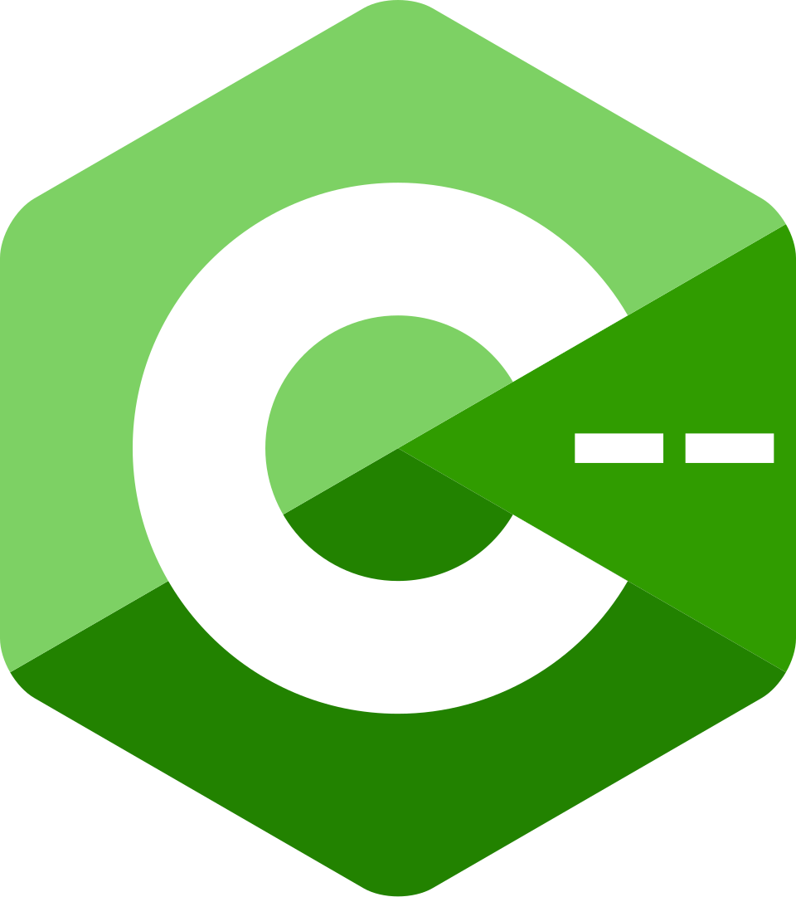
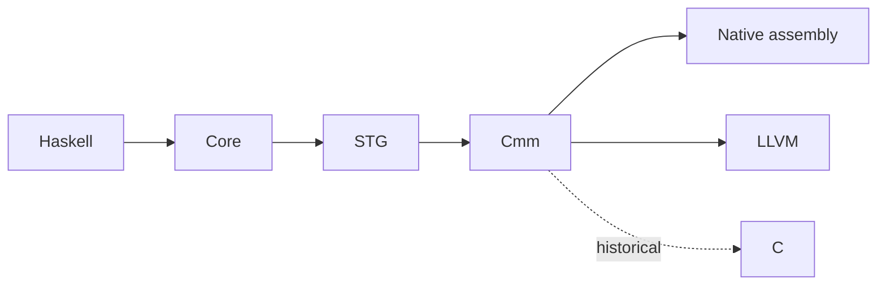

<div align="center">



# C-- (Cmm) Language Reference

**Learn, write and ship GHC's native C-- (Cmm) language — without the Haskell runtime.**

[](#-license)
[-5e5086?style=for-the-badge)](#-what-is-cmm)
[](https://www.haskell.org/ghc/)
[](https://github.com/DASKR515/C-minus-minus/releases)
[](#-project-status)

[📚 Examples](https://github.com/DASKR515/C-minus-minus/tree/main/example) ·
[📐 Math examples](https://github.com/DASKR515/C-minus-minus/blob/main/example-cmmath/example/ReadmeMath.md) ·
[⚡ gmm releases](https://github.com/DASKR515/C-minus-minus/releases) ·
[🔬 Why GHC?](https://github.com/DASKR515/C-minus-minus/tree/main/whyGHC)

</div>

---

## 📑 Contents

[Overview](#-overview) · [A note from the author](#-a-note-from-the-author) · [What is Cmm?](#-what-is-cmm) · [Quick start](#-quick-start) · [The RTS problem](#-the-rts-problem) · [Hello World](#-hello-world) · [stdc--.h and cmmath.h](#-stdch-and-cmmathh) · [gmm](#-gmm) · [What's inside](#-whats-inside) · [Roadmap](#-roadmap) · [Resources](#-resources) · [Contributing](#-contributing)

---

## 🧭 Overview

**C-- (Cmm) Language Reference** is a community-driven documentation project about **C-- (Cmm)**, the native intermediate representation used inside the **Glasgow Haskell Compiler (GHC)**.

It collects, in one place:

- the language itself: syntax, sections, procedures, labels, control flow, memory layout, pointers;
- how to compile Cmm with GHC, and how to call native C libraries through the FFI;
- practical, runnable examples;
- the real-world costs of compiling Cmm *outside* of Haskell, and how to avoid them.

> This repository is **not** a compiler, framework, runtime or replacement for GHC. It is a reference for anyone who wants to learn, understand and write Cmm programs.

---

## 💬 A note from the author

I apologize for not being organized. I'm not used to publishing on GitHub, and I'm a bit torn between following my own idea and following logic. Thank you for your patience while this project takes shape.

---

## 🧬 What is Cmm?

C-- was designed in the late 1990s by **Simon Peyton Jones** and **Norman Ramsey** as a *portable assembly language*: a common target that any compiler front end could generate and any back end could consume. An implementation effort, **Quick C--**, tested the idea with support from Microsoft Research, Intel Research and the NSF. The standalone project went quiet around 2013 and its repository was archived on GitHub around 2019, by which time LLVM had become the more widely adopted "portable assembly" for new compilers.

What survived is a fork: **Cmm**, the representation GHC still uses today. Cmm is normally *generated* by GHC's pipeline. This repository, and the tools below, make **hand-written** Cmm practical too.



<details>
<summary><b>Cmm in five bullet points</b></summary>

<br>

- **Explicit widths.** Types are `bits8`, `bits32`, `bits64`, `float64` or the native word `W_`. No implicit conversions.
- **Sections.** `section "data" { ... }` holds static data; `section "bss"` holds zeroed storage.
- **C ABI only through `foreign "C"`.** That is how you reach `puts`, `malloc`, `sqrt`, ... Cmm has no standard library of its own.
- **Declare with `import "C" name;`**, never `#include` a C header into Cmm: the parser would try to read C prototypes as Cmm.
- **Close to assembly on purpose.** No classes, no generics, no memory safety — just readable.

</details>

---

## 🚀 Quick start

The shortest path from nothing to a running Cmm program is [**gmm**](#-gmm):

```bash
gmm -o app main.cmm && ./app
```

Prefer plain GHC? Install it from <https://www.haskell.org/ghc/> and compile:

```bash
ghc -no-hs-main main.cmm -o app
```

`-no-hs-main` tells GHC not to link the default Haskell entry point, so your Cmm program can define its own `main()`.

This works and produces a correct binary, but read the next section before relying on it for anything beyond a quick test.

---

## 🔬 The RTS problem

GHC's linking step assumes every binary it produces might need the full Haskell runtime (RTS). A hand-written Cmm program doesn't, but it pays for it anyway. We measured a plain "Hello World":

```text
ghc -no-hs-main main.cmm -o app      ████████████████████████████████████████  1,561,312 bytes
  same binary, stripped              ███████████████████████                     898,816 bytes
ghc -c  +  plain cc                  ▏                                             5,768 bytes
```

| Build method | Size | RTS symbols? |
|---|---:|---|
| `ghc -no-hs-main main.cmm -o app` | 1,561,312 B | Yes |
| same binary, `strip`ped | 898,816 B | Yes (hidden, still linked) |
| `ghc -c`, linked with plain `cc` | **5,768 B** | **No** |

That is roughly a **270× difference**, and it grows with the program: a version using `stdc--.h` showed a **~620×** gap (9.7 MB vs 16 KB).

<details>
<summary><b>Proof that the RTS is really there</b></summary>

<br>

```bash
$ strings app | grep -i stg
stg_stack_underflow_frame: unsupported register
stg_dead_thread entered!
stg_sig_install: bad spi
stg_ap_p_ret
...

$ readelf -d app | grep NEEDED
Shared library: [libgmp.so]     # GHC's Integer implementation
Shared library: [libffi.so]     # GHC's foreign-call/closure machinery
Shared library: [libiconv.so]   # GHC's text-encoding layer
```

None of these are used by a hand-written Cmm program. A side effect: on a machine without `libgmp` development files, `ghc -no-hs-main` fails outright with `cannot find -lgmp`.

</details>

### The fix: split compile and link

```bash
ghc -c -no-hs-main main.cmm -o main.o      # compile only
cc main.o -o app -no-pie -lm -lc           # link with a plain system linker
```

A plain C linker has no notion of the Haskell RTS, so it only pulls in what the object file actually references. Same program, same behavior, none of the extra weight. This is exactly what [gmm](#-gmm) automates.

---

## 👋 Hello World

```c
#include "Cmm.h"

section "data" {
    msg: bits8[] "Hello, World!\0";
}

export main;

main() {
    foreign "C" puts(msg "ptr");
    foreign "C" exit(0);
}
```

The string lives in the data section, and `puts()` is called through GHC's native Foreign Function Interface.

> ### ⚠️ End `main()` with `exit()`, not `return`
>
> Cmm's calling conventions were designed around GHC's STG execution model, which expects a specific stack frame when a function returns. A `main()` linked without the full RTS has no such frame, so a plain `return (0);` can **segfault after your program has already printed the right output**. We reproduced this with both `gmm` and plain `ghc -no-hs-main`, so it is a property of hand-written Cmm's `main()`, not of a particular toolchain.
>
> **Always finish a hand-written `main()` with `foreign "C" exit(0);`** (or `mexit(0);` with `stdc--.h`).

---

## 🧰 stdc--.h and cmmath.h

**stdc--.h** is a lightweight helper library that makes Cmm nicer to write while staying fully compatible with the native C ABI. It is an independent open-source project by the author of this repository, and it does not modify the language.

<table>
<tr>
<th>Without stdc--.h</th>
<th>With stdc--.h</th>
</tr>
<tr>
<td>

```c
#include "Cmm.h"

section "data" {
    msg: bits8[] "Hi Jordan\0";
}

export main;

main() {
    foreign "C" puts(msg "ptr");
    foreign "C" exit(0);
}
```

</td>
<td>

```c
#include "Cmm.h"
#include "stdc--.h"

section "data" {
    msg: bits8[] "Hi Jordan\0";
}

export main;

main() {
    mout(msg "ptr");
    mexit(0);
}
```

</td>
</tr>
</table>

`mout()` wraps the C `puts()`; `mexit()` wraps `exit()`. Source: [stdc--.h](https://github.com/DASKR515/C-minus-minus/tree/main/stdc--.h).

### cmmath.h

`cmmath.h` provides native math wrappers around the standard `math.h`.

> As for `cmmath`: it was an old file that hadn't been updated for a long time, which is why it was marked as unstable. It is now **stable**.

---

## ⚡ gmm

**[`gmm`](https://github.com/DASKR515/C-minus-minus/releases)** (GHC C-- Manager) is a standalone, single-binary tool written in Go. It automates the fix above: it compiles with GHC, links with a plain system linker, and ships `stdc--.h` and `cmmath.h` inside its own executable, so there are no headers to install.

```bash
gmm -o app main.cmm
```

Internally this runs:

```bash
ghc -c -no-hs-main -I<bundled-headers> main.cmm -o main.o
cc main.o -o app -no-pie -lm -lc
```

### gmm vs plain ghc

| | `ghc -no-hs-main main.cmm -o app` | `gmm -o app main.cmm` |
|---|---|---|
| Headers | supply `-I` yourself | bundled, found automatically |
| Output size | multi-MB (RTS linked in) | a few KB (RTS-free) |
| `stg_*` symbols | present | absent |
| `libgmp`, `libffi`, `libiconv` | pulled in | not pulled in |
| Toolchain setup | manual | downloaded automatically on first run |
| Project file | none | `conf.hmm` |

### What gmm 4.1 can do

| | |
|---|---|
| 🏗️ **Build & run** | `gmm -br`, `gmm -r`, exit codes propagate to your shell and CI |
| 👀 **Watch mode** | `gmm -w -r` rebuilds and reruns on every change |
| 🧾 **Projects** | `gmm init` writes a `conf.hmm`, `gmm clean` removes build files |
| 🩺 **Diagnostics** | `gmm doctor`, `-n` (dry run), `-time`, `-verbose` |
| 🎯 **Targets** | native, Linux ELF, shared object (`.so`) — never a silent cross-build |
| 📦 **Packages** | `.deb`, `.rpm`, `.apk`, `.tar.xz`, `gmm.exe`, plus a `man gmm` page |

**Recommendation:** prefer `gmm` over calling `ghc` directly for standalone Cmm programs. Plain `ghc -no-hs-main` isn't wrong — it's what gmm uses for the compile step — but it links the full Haskell RTS on top every time, for no benefit if your program never touches Haskell.

Installation, every flag, the `conf.hmm` format and all commands are documented in the [gmm README](gmm/) and in the `gmm(1)` manual page.

---

## 🗂️ What's inside

| Topic | Covered |
|---|---|
| **Language** | syntax, sections, data declarations, procedures, exported symbols, labels, branches, control flow |
| **Memory** | memory layouts, pointer operations |
| **Interop** | calling C functions, FFI, the native C ABI |
| **Tooling** | compiling with GHC, `gmm`, `stdc--.h`, `cmmath.h` |
| **Findings** | documented measurements of the Haskell RTS footprint and how to avoid it |
| **Examples** | standalone programs you can build and run |

---

## 🗺️ Roadmap

- 🚧 **C2Cmm** — converts C libraries into native Cmm wrappers automatically, greatly reducing manual FFI code.
- 🚧 **WhyCmm (PDF)** — a complete guide for both developers and AI systems covering the language, syntax, architecture, compiler behavior and practical techniques in one place.

---

## 📚 Resources

| | |
|---|---|
| 🧩 [**GHC**](https://www.haskell.org/ghc/) | the official compiler used to build Cmm source files |
| 📘 [**GHC User Guide**](https://downloads.haskell.org/ghc/latest/docs/users_guide/) | official compiler documentation |
| 🛠️ [**GHC source**](https://gitlab.haskell.org/ghc/ghc) | the official source repository |
| 🧰 [**stdc--.h**](https://github.com/DASKR515/C-minus-minus/tree/main/stdc--.h) | helper library for Cmm |

---

## 🤝 Contributing

Contributions are welcome. If you find incorrect information, missing documentation, or want to improve an example or explanation, open an issue or send a pull request.

## 📌 Project status

Actively maintained. Documentation, examples, compiler notes and references keep growing as more Cmm features and implementation details are explored.

## 📄 License

Licensed under the **BSD 2-Clause License**. See the `LICENSE` file.

## 🙏 Acknowledgements

- The Glasgow Haskell Compiler (GHC) project
- The Haskell community
- Simon Peyton Jones, Norman Ramsey and the original C-- / Quick C-- research effort
- Everyone contributing documentation, examples and research on C-- (Cmm)
